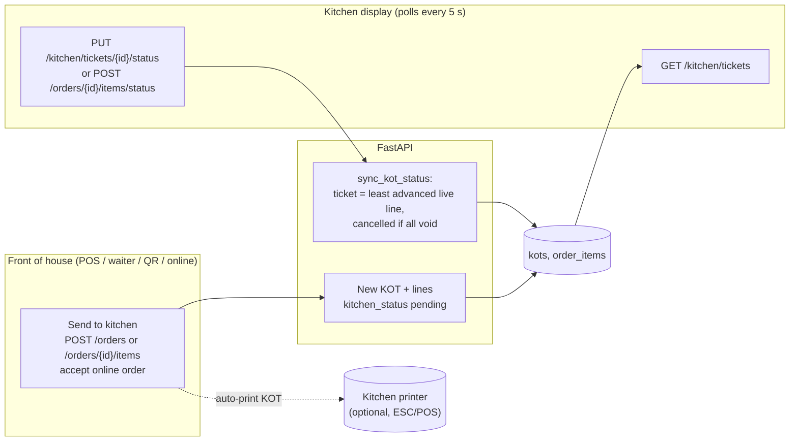
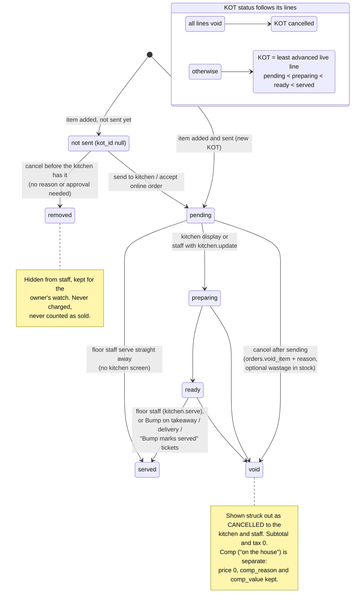

# Kitchen Display System (KDS) & KOTs

## 1. Overview
The kitchen display replaces paper tickets. It is the same Storant app signed in with a **kitchen** role, on a wall TV, a tablet or a phone. Every time items are sent to the kitchen, a **KOT** (kitchen order ticket) appears; cooks move each item through Preparing → Ready and then **Bump** the ticket off the screen. **Served** is set on the floor (waiter, cashier, manager, owner), never by the kitchen. A KOT can also be printed on a kitchen printer.

## 2. Key capabilities
* **Tickets appear within seconds:** the display polls the server every 5 s. There are no WebSockets and no LAN-only device-to-device protocol.
* **Per-item status:** every line has its own status, so "2 ready, 2 cooking" is visible. The ticket shows the slowest live line.
* **Timers and colours:** tickets turn amber/red after the thresholds set in Settings (`kitchen_amber_min`, `kitchen_red_min`).
* **Voice (Hindi):** besides the beep, new tickets are said out loud in Hindi, in Devanagari: "नया ऑर्डर आया है। टेबल 5।", "स्विगी का नया ऑर्डर आया है।", several at once in one line. Item names are off by default (Settings → Account → Voice alerts). Tickets already on screen when it opens or reloads are never announced. Per device, mic button in the header; while it is on, the screen is kept awake (Screen Wake Lock API, where supported). Web / PWA only for now (browser `speechSynthesis`; the native apps have no voice engine yet). The browser needs one tap before it may speak ("Tap to turn on voice").
* **Cancelled items struck out:** items cancelled after the kitchen had them show as **CANCELLED**, so nobody cooks them.
* **Brands:** in cloud kitchens each ticket shows its brand.
* **Bump is not Served.** Bump (`POST /kitchen/tickets/{id}/bump`) only clears a ready ticket off the screen (`kots.bumped_at`); dine-in food stays **Ready** until floor staff mark it served, because a dine-in bill can only be paid once its food is served (pay rules, [017](./017_Running_Bills_And_Floor.md)). Takeaway, delivery and aggregator tickets have no waiter, so Bump marks their food served. Owners of counter-service places without waiters can turn on **Settings → Kitchen rules → Bump marks served** (`bump_marks_served`, default off) so Bump serves dine-in food too.
* **Who serves:** `kitchen.serve` (waiter, cashier, manager, owner; never the kitchen role). The server refuses `served` from anyone without it. Kitchen staff (`kitchen.update`) move food up to Ready and back; tapping a line on the kitchen screen stops at Ready, and a line the floor already served is left alone.
* **No kitchen screen?** Floor staff mark items served straight from Pending, Preparing or Ready on the bill, or with one tap: **Mark all served** ([017](./017_Running_Bills_And_Floor.md)).
* **Offline:** the kitchen display needs the server. A shop that must keep the kitchen running during internet outages runs the server on a shop PC ([17](../17_Free_Cloud_Deployment.md)); printed KOTs from the POS also work.

## 3. How to use
1. Sign in on the kitchen device with a kitchen account and open **Kitchen**.
2. Each ticket shows table or token, channel/brand, time elapsed and its items with notes.
3. Tap an item (or the whole ticket's **Start** / **Ready** button) to move it to **Preparing**, then **Ready**. Waiters see the progress on the table and the bill ("2 ready to serve"); customers who ordered by QR see it on their phone.
4. **Bump** clears the ready ticket off the screen. **Undo** (8 s) or **Recall** (tickets bumped in the last 2 hours) brings it back; food the floor already served stays served, food the bump itself served goes back to Ready.
5. The waiter marks the food **Served** at the table (or **Mark all served**). If a dish goes back to cooking, its ticket returns to the kitchen screen by itself.

## 4. Under the hood

Item and ticket states:

<!-- diagram: 07_kitchen_item_status drawio=Tallyko_Order_Flow -->

*Diagram source: [`07_kitchen_item_status.mmd`](../diagrams/mermaid/07_kitchen_item_status.mmd) · [SVG](../diagrams/rendered/07_kitchen_item_status.svg) · draw.io: [`Tallyko_Order_Flow.drawio`](../diagrams/Tallyko_Order_Flow.drawio)*
<!-- /diagram -->

**API:**
- `GET /kitchen/tickets?status=active|ready|recent|all`: per-line status, bill label, `bumped_at`. `active` = not bumped and not done; `recent` (Recall) = bumped, served or cancelled in the last 2 hours.
- `POST /kitchen/tickets/{id}/bump` (`kitchen.update`; 409 until the food is ready; answers `served: true|false`) and `POST /kitchen/tickets/{id}/recall`.
- `PUT /kitchen/tickets/{id}/status`: whole ticket Start / Ready / back. Moving a ticket back clears its bump. `served` here needs `kitchen.serve`; from a caller without it (the kitchen screen of an older app build) it is treated as a Bump.
- `POST /orders/{id}/items/status`: single items. `preparing`/`ready` need `kitchen.update`, `served` needs `kitchen.serve`.
- `GET /kitchen/kds/orders` and `PUT /kitchen/kds/orders/{kot_id}/status` remain for older app versions (same rules).

**Tests:** `backend/tests/integration/test_kitchen.py`, `test_floor.py`, `test_pay_flow.py`; frontend `features/ops/__tests__/floorLogic.test.ts`.
