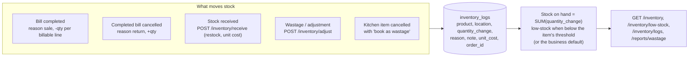

# Inventory Management

## 1. Overview
The Inventory Management module is the backbone for operational efficiency, ensuring that businesses never unknowingly run out of stock and can trace every missing item. It supports both simple quantity tracking and complex multi-variant tracking.

## 2. Key Capabilities
* **Real-Time Deduction:** Stock is taken the moment an item is saved on a bill (not at payment), so "2 left" means 2 can still be sold. Cancelled items and bills give it back (see section 5).
* **Low-Stock Alerts:** Visual indicators and dashboard warnings when an item drops below its defined threshold.
* **Audit Trail (Ledger):** Instead of just overwriting a number (e.g., changing 50 to 45), the system maintains an immutable ledger of transactions (e.g., `-5 sold`, `+20 purchased`, `-1 wasted`).
* **Wastage Tracking:** Allows staff to log spoiled or damaged goods, keeping inventory accurate and providing insights into operational losses.

## 3. How to Use

### A. Initializing Stock
1. Go to **Menu** and create or edit an item.
2. Toggle **Track Inventory** to ON.
3. Enter the current physical stock count and the **Low Stock Alert** threshold.

### B. Viewing and Managing Stock
1. Navigate to the **Inventory** tab on the bottom navigation bar.
2. A searchable list of all tracked items appears. Items below their threshold are highlighted in red.
3. Tap on any item to view its **Stock Ledger** (history of all additions, sales, and deductions).

### C. Adding Stock (Receiving Delivery)
1. In the **Inventory** tab, tap the `+` or `Add Stock` button.
2. Select the product, enter the quantity received from the supplier, and optionally enter the purchase price.
3. The new quantity is appended to the ledger and the total stock is dynamically updated.

### D. Logging Wastage
1. Select a product in the **Inventory** tab.
2. Tap **Log Wastage/Damage**.
3. Enter the quantity to remove and a brief reason (e.g., "Dropped on floor"). The stock is reduced accordingly.

## 4. Under the Hood (Data Flow)

Stock on hand is the sum of `inventory_logs.quantity_change` per product: an append-only ledger the app's database role cannot delete from. Only products with `track_stock` are counted.

Offline bills apply as differences when they sync, so nothing is overwritten. Tests: `backend/tests/integration/test_orders.py` (stock deduction and reversal), `test_floor.py` (wastage on cancel).

## 5. Stock counter, sold out and "N left" (Nov 2026)

### What people see
- **POS** (grid and list): a tracked item shows **"N left"** at or below its alert level (the item's own, else Settings → Business → Low stock alert at). At zero or below it shows **Sold out** (greyed); tapping it, scanning its barcode or adding it to a running bill stops with "Masala Chai is sold out." / "Buttermilk: only 2 left." The cart can't go past what is left.
- **When two tills sell the last units at once**, the server decides: one bill goes through, the other gets **Not enough stock** with **Fix the bill** (lowers each item to what is left, removes sold-out ones) and, for owners and managers, **Sell anyway** (asks for a reason; the owner sees it on Owner's watch as "Sold an item past its stock").
- **QR table ordering and the own online store**: sold-out items show **Sold out** instead of Add; guests never see how many are left. An order that runs into a sold-out item is refused with the item's name, and the menu reloads.
- **Delivery apps** (Swiggy, Zomato… webhook) and **offline bills** are never refused for stock: they are accepted, stock may go below zero, and the owner / manager sees "Orders accepted short on stock" on Home (alert and Low stock card) and in the activity log (`stock.short`).
- **Inventory**: the same number as the POS. Items tracked but never counted say **Not counted** (they always sell). The owner gets a one-time banner listing items at or below zero ("fix with Set count"). **Set counted quantity** (Set count) writes the difference as an adjustment and starts the counter. Stock history shows who made each change.
- **Settings → Business → Inventory → Sell items at or below zero**: off by default for every business (blocking on). Turning the Inventory module off also stops all blocking.

### Rules
- Stock is a ledger (`inventory_logs`) **plus a counter** `products.stock_on_hand`, kept in step in the same transaction by `app/services/stock_service.py`, the only code that changes stock. Every counter change also bumps `products.updated_at` (so `/sync/pull` carries it). `python manage.py stock:check [--fix]` compares the two.
- **Counted** = the counter is not NULL: the item has a stock entry made by hand (opening stock, stock in / out, wastage, adjustment, Set count). Only counted, tracked items can be sold out. Untracked items always sell.
- **When stock moves**: a line takes its stock the moment it is saved on a bill (new bill, add items, Repeat, QR / online / delivery order) and is marked `order_items.stock_held`. Cancelled / removed lines, kitchen-cancelled tickets and cancelled, rejected, archived or deleted bills give it back. Payment cuts stock only for lines that don't hold it yet (lines saved before this change, free offer items), so nothing is ever deducted twice. Void with waste = back, then wastage (net: the wastage). On the house keeps the stock taken. Split / move / merge move the held stock with the line.
- **Race**: the products are locked (`SELECT … FOR UPDATE`, only tracked + counted ones, in id order, always after the bill's own lock) before their counters are read.
- **Policies**: POS, add items, Repeat, barcode, QR, online store: refuse (`409 STOCK_SHORT`, `details.items: [{product_id, name, requested, available}]`; guests get names only). Owners / managers (`inventory.manage`) may send `stock_override_reason` (audited as `stock.override`). Delivery-app webhook, offline sync and seeders: always sell (`stock.short` audit when short).
- **Variants** (Half / Full) take one unit of the item each. Stock is whole numbers only (no kg / litre yet). Recipes / ingredients don't exist.
- **Reports and Home**: Inventory's stock value, the Low stock card on Home (cache 30 s) and the POS all read the counter. The wastage report still reads wastage entries.
- **API**: `GET /catalog/stock?since=` (sign-in, RLS; the POS polls it every 20 s while billing), products carry `stock` and `sold_out`, the public menu carries `sold_out` only, `POST /inventory/count`.

### Database (migration 0067, one file)
`products.stock_on_hand` (backfilled from the ledger for tracked items with a hand-made entry; idempotent), `order_items.stock_held`, `inventory_logs.created_by` + index `(tenant_id, product_id)`, `business_settings.allow_sell_at_zero` (false). The downgrade removes them; the ledger is untouched.

### Not done (on purpose)
- Telling Swiggy / Zomato an item is out of stock: the integration only receives orders. It needs partner API approval or a connector that we call with an outgoing `item.stock_changed`; until then staff switch the item off in the partner app.
- Weight / volume units, per-variant stock, recipes, stock per outlet (one location today).
- Sell anyway from the running bill's Repeat sheet (it shows the sold-out message; repeat from the billing screen to sell anyway).

Tests: `backend/tests/integration/test_stock.py` (counter vs ledger, 10 − 8 = 2 everywhere, holds and give-backs, two waiters racing for the last 2, every channel, sell anyway, never-counted / allow-at-zero / module off, a bill from before the change paid once, every cancel path, tenant isolation), `frontend/src/features/pos/__tests__/stock.test.ts`, `features/catalog/__tests__/bulk.test.ts`.
