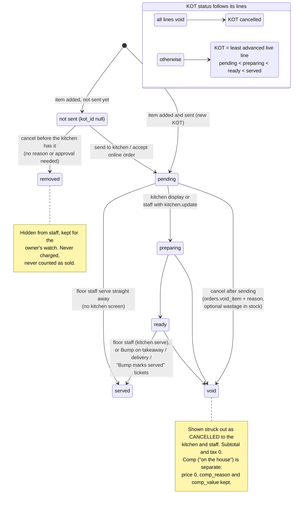
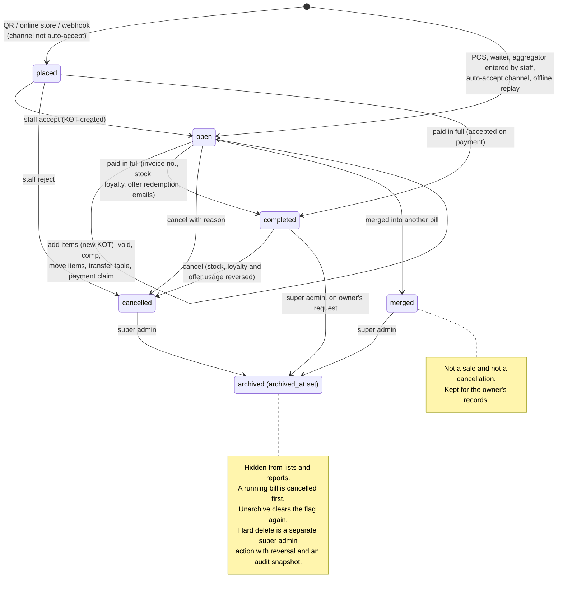

# 017 · Running Bills on the Floor

Restaurants change orders all the time. This module covers what happens between "order taken" and "bill paid", from a one-person café to a large restaurant.

## Situations covered

| Situation | What Tallyko does |
|---|---|
| "Two more rotis" | Add items to the running bill. They go to the kitchen as a **new KOT** (Pending), so a dine-in bill can't be paid again until they are served; the earlier rotis keep their own status. |
| 4 items, 2 ready, 2 cooking | Every line has its own kitchen status: Pending → Preparing → Ready → Served. A ticket shows the slowest line. |
| Kitchen bumps a ticket | Bump only clears it off the kitchen screen; dine-in food stays **Ready** ("2 ready to serve" on the table) until the waiter serves it. See [005](./005_Kitchen_Display_System.md). |
| No kitchen screen (owner alone, small café) | Waiters, cashiers, managers and owners (`kitchen.serve`) mark items served straight from Pending, Preparing or Ready, or tap **Mark all served**. The kitchen role can't mark served. |
| Customer wants to pay before the food arrives | Dine-in: Pay stays off ("2 items not served yet") until everything is served. The owner or a manager can **Pay anyway** with a reason (audited). See *When a bill can be paid* below. |
| Bill already paid / part-paid | No more items: a paid bill answers "This bill is paid. Start a new order." (`BILL_CLOSED`), a part-paid one refuses new items (`BILL_PART_PAID`). After payment the table frees and the next order is a new bill. |
| Customer cancels 1 of 3 rotis the kitchen already has | Partial cancel. A reason is required, and `orders.void_item` is needed (managers/owners). The kitchen sees the item struck out as **CANCELLED**. Optionally book it as wastage in stock. It is never charged. |
| Item not sent to the kitchen yet | Removed straight away; no reason or approval needed. |
| On the house (birthday, complaint) | Complimentary line: price 0, reason and normal value kept for reports. Needs `orders.discount`. |
| Two parties at one table | Several bills per table ("Bill 2", or a guest's name). Opening a second bill is explicit, so nobody adds to the wrong bill by accident. |
| "Separate bills please" | Move selected items, or part of a line, to another bill or to a new bill on the same table. |
| Tables pushed together / one person pays for all | Merge bills. The emptied bill is kept as **merged** (not a sale, not a cancellation). |
| Party moves to a busy table | Transfer a bill; it joins as an extra bill on that table. |
| A waiter covers a colleague's table | Staff who can see tables can open and serve **every running table bill**. Closed bills of others stay private unless `orders.view_all`. |
| Bill made offline on a table that got another bill meanwhile | It syncs as a separate bill on that table; it is never lost. |

## Item and ticket status

<!-- diagram: 07_kitchen_item_status drawio=Tallyko_Order_Flow -->

*Diagram source: [`07_kitchen_item_status.mmd`](../diagrams/mermaid/07_kitchen_item_status.mmd) · [SVG](../diagrams/rendered/07_kitchen_item_status.svg) · draw.io: [`Tallyko_Order_Flow.drawio`](../diagrams/Tallyko_Order_Flow.drawio)*
<!-- /diagram -->

## Bill states

<!-- diagram: 06_order_lifecycle drawio=Tallyko_Order_Flow -->

*Diagram source: [`06_order_lifecycle.mmd`](../diagrams/mermaid/06_order_lifecycle.mmd) · [SVG](../diagrams/rendered/06_order_lifecycle.svg) · draw.io: [`Tallyko_Order_Flow.drawio`](../diagrams/Tallyko_Order_Flow.drawio)*
<!-- /diagram -->

## Voice alerts for the floor ("टेबल 5 का ऑर्डर तैयार है")

Waiters, cashiers, managers and owners hear, on any screen of the app, when a dine-in table's food is ready, and a reminder until it is served. Takeaway, delivery and online orders never call a waiter.

- **When:** a kitchen ticket (per bill) counts as ready once **every live item on it is Ready** (cancelled items left out) and not all are served. It is announced **once per ticket**: Ready and then Bump don't announce twice, a ticket sent back and readied again isn't announced again, a new KOT on the same table is.
- **Reminder:** "याद दिलाना: टेबल 5 का ऑर्डर अभी तक परोसा नहीं गया।" every 1 minute by default (30 s, 2 min or off per device) until it is served, bill paid or cancelled. Several tables go in one line ("टेबल 2 और टेबल 5 …"). Table names are read as written.
- **Start-up:** after opening or reloading the app, tickets that were already ready are not announced; only their reminders start.
- **Mute 5 min:** a small pill at the top shows the waiting tables with "Mute 5 min" / "Unmute". Nothing piles up while muted; reminders resume on schedule.
- **Only my tables:** per device, limits alerts to tables assigned to this waiter (`tables.assigned_staff_id`).
- **How:** the app polls `GET /tables/ready-to-serve` every 10 s while visible (`features/ops/FloorAnnouncer.tsx`; decisions in `announcer.ts`, unit-tested); speech is the browser's `speechSynthesis` with the best Hindi (female) voice on the device (`lib/voice.ts`, lines in `lib/voiceLines.ts`). The screen is kept awake while alerts are on. Settings are per device (Settings → Account → Voice alerts; `store/voicePrefs.ts`); there is no business-wide setting and no database change. Native apps: not yet (no engine); push notifications for locked phones are not part of this.

## When a bill can be paid (pay rules)

The owner sets, per order type, when a bill may be paid: **Anytime**, **After items are ready** or **After items are served** (Settings → Kitchen rules; business setting `pay_rules`). Defaults: dine-in after served; takeaway, counter walk-in and delivery any time. Only the order types the business uses are shown (restaurant / café: dine-in, takeaway, delivery; cloud kitchen: takeaway, delivery; retail: counter walk-in, takeaway, delivery).

- **Enforced on the server** (`order_service.pay_gate`) on the first payment of a bill, in `POST /orders/{id}/pay` and in `POST /orders` with payments. Refused with **409 `PAY_BLOCKED_ITEMS`** and `details` `{level, order_type, unsent, cooking, ready, blocking}` (quantities); the till shows it in the person's language and keeps Pay off with the reason (`frontend/src/lib/payGate.ts` mirrors the rule).
- Counted: live kitchen lines not yet served (or not yet ready for the "ready" rule), and kitchen items not sent yet. Never counted: cancelled lines, items that don't go to the kitchen, free offer items never sent.
- Never held: bills with a payment already (the rest can always be collected), bills on channels other than POS and table QR (online store, Swiggy / Zomato / other aggregators), a confirmed QR UPI claim, offline bills replayed by `/sync/push` (the money was already collected), and every bill when the Kitchen module is off.
- **Pay anyway:** the owner and managers (`orders.pay_override`) send `override_reason` (3–200 characters) with the payment. It is written to the audit log as `order.pay_override` and shows on the owner's Watch. Cashiers get 403.
- Split bills are judged on their own lines; merged bills on the merged lines; a bill moved to a table becomes dine-in.
- Stock is deducted when a bill is paid, so on dine-in it now moves after serving.

## Rules that protect the money

- Items can't be moved, cancelled or comped after a payment has been taken on that bill. Use cancel or refund for the whole bill.
- Items can't be added to a bill with a payment (`BILL_PART_PAID`) or to a paid, cancelled or merged bill (`BILL_CLOSED`, `details.status`).
- Paying and changing a bill lock its row (`load_order(..., for_update=True)`; split and merge lock both bills in a fixed order), so a waiter adding items while the cashier pays can't put items on a bill that just closed.
- Every change re-prices the affected bills with the same engine: GST snapshot, offers re-checked, manual discount kept.
- Reports, stock and GST summaries ignore cancelled lines.
- Every cancel, comp, split and merge goes to the activity log with who did it and why.

## API

- `POST /orders/{id}/items/status`: set the kitchen status of items (`served` needs `kitchen.serve`).
- `POST /orders/{id}/pay`: take payment (pay rules; `override_reason` for Pay anyway).
- `POST /orders/{id}/items/void`: cancel items.
- `POST /orders/{id}/items/comp`: on the house.
- `POST /orders/{id}/items/move`: split a bill.
- `POST /orders/{id}/merge`: merge bills.
- `PUT /orders/{id}/details`: change the bill label or guest count.
- `POST /orders` with `new_bill: true` opens a second bill on an occupied table.
- `GET /tables` returns `open_bills` per table, with kitchen progress counts.

The logic lives in `backend/app/services/floor_service.py` and `order_service.py` (pay rules), with tests in `backend/tests/integration/test_floor.py`, `test_pay_flow.py` and `test_bill_locks.py`.
